

# CCI Posts Carousel All In One

Previously **WP Posts Carousel All In One**. Following WordPress’s decision about “WP” in the plugin name and slug, the product now uses the CCI name. Existing carousel IDs, saved settings, Gutenberg blocks and `[wp_posts_carousel]` shortcodes remain supported.

Your latest articles, your favourite guides, the pages you wish more people would discover. Bring them together in a carousel that invites visitors to keep exploring.

[See it in action](https://wordpress-demo.coolcatideas.com/) · [Explore the product](https://coolcatideas.com/products/cci-posts-carousel-all-in-one/) · [Read the guide](https://coolcatideas.com/docs/cci-posts-carousel-all-in-one/) · [Get help](https://github.com/cool-cat-ideas/cci-posts-carousel-all-in-one/issues)

Choose your content, arrange your slides and preview the result in the visual editor. Place your saved carousel with a Gutenberg block or shortcode, then reuse it across your site. Change it once and every place using it stays in sync.

We're **Cool Cat Ideas**, and we're proud of this plugin. We built it for the enjoyable part of putting a page together: choosing what deserves attention and finding the right way to present it. We'd love to see what you create.

## Plenty to create with, right from the start

- Unlimited saved carousels with a visual editor and manual slide ordering.
- Pin selected slides first and automatically fill the remaining places with matching posts, without duplicates.
- Optionally show a second image on mouse hover, from article content, the WooCommerce gallery or your own selection. Featured images stay primary; touch screens keep the primary image.
- Post and taxonomy queries, frontend taxonomy filters, and custom field mapping.
- Owl Carousel and Swiper engines, with responsive and asset compatibility settings.
- Default, Light and Simple templates.
- Gutenberg block and shortcode embedding.
- WordPress Popular Posts ordering when that plugin is installed.
- Developer hooks for custom queries, templates and integrations.

WooCommerce products can appear as standard linked content cards in Free. Current prices, sale information and buying actions require the separate Pro plugin.

## Take it further with Pro

CCI Posts Carousel All In One Pro adds WooCommerce buying actions, Commerce Luxe, Video Showcase, Story Commerce, Elementor integration, engagement reports, autoplay progress indicators and Multisite tools. It is installed alongside the Free plugin.

[Explore Pro and compare editions](https://coolcatideas.com/products/cci-posts-carousel-all-in-one/)

Aurora Cards is a separate, no-cost template extension. Its product example below uses Pro for WooCommerce prices and Add to cart actions; Aurora Cards is not one of the three templates bundled with Free.

## Get started

Declared compatibility: **WordPress 6.2 through 7.1.3** and **PHP 7.4 or later**.

1. Install and activate the packaged plugin ZIP in **Plugins → Add New → Upload Plugin**.
2. Open **CCI Posts Carousel All In One**, create a carousel and choose its content and layout.
3. Save it, then select it in the **CCI Posts Carousel All In One** block or copy its shortcode.
4. Check the published page on desktop and mobile.

For image previews, open **Design > Second image on hover**, enable the option and choose a source. It is off by default and included in the base plugin. Try [A second image on hover](https://wordpress-demo.coolcatideas.com/cci-posts-carousel-demo/#wpc-demo-carousel-image-hover-free).

See the [user guide](docs/2.1.0/user-guide.md) for configuration and the [developer guide](docs/2.1.0/developer-guide.md) for extensions.

## Updating from 2.0.x to 2.1.0

This includes 2.0.0 through 2.0.4. Update directly; your saved carousels,
settings, IDs, Gutenberg blocks and existing `[wp_posts_carousel]` shortcodes
stay supported. You do not need to recreate carousels or replace shortcodes.

1. Back up the WordPress files and database. Try the update on a staging copy first.
2. Leave **WP Posts Carousel All In One** installed and active. Download
   `cci-posts-carousel-2.1.0.zip` from the [product page](https://coolcatideas.com/products/cci-posts-carousel-all-in-one/).
   Open **Plugins → Add New Plugin → Upload Plugin**, then upload and install it.
   The old and renamed plugins appear as two entries because their folders differ.
3. Click **Activate** for **CCI Posts Carousel All In One**. Activation switches
   WordPress to the renamed package and makes the old entry inactive. Your saved
   carousel data stays in place.
4. If you use Pro, an already active Pro 2.0.0 can stay active. Update Pro and
   external add-ons separately when their renamed ZIPs are available. The base
   and Pro version numbers do not need to match, and an active license does not
   need to be entered again.
5. Clear the site cache. Open the saved carousel list and check an existing page
   on desktop and mobile, including any Pro layouts or WooCommerce buttons.

**Do not click Delete on the old plugin entry in WordPress.** Its uninstall
routine may remove shared carousel data. Keep its inactive folder while you
verify the site. If you later remove old files, use SFTP or the hosting file
manager after confirming that the renamed replacements are active.

See the [full update guide](docs/2.1.0/user-guide.md#updating-from-the-previous-package-name)
for the checks and rollback steps. Image on hover remains off unless you enable it.

Updating from 1.x? Version 2.x rewrites the carousel data model, widgets and shortcode configuration. Recreate your carousels in the new editor and replace every old placement. Follow the [upgrade guide](docs/2.1.0/upgrading-from-1.x.md) for the steps and a screenshot of the dashboard.

The [plugin readme](readme.txt) includes the changelog and explains marketplace requests, optional review submissions and icon CDN loading.

## Screenshots

The admin screenshots show a demo installation with Pro active. Captions identify Pro features and optional extensions. Expand a screenshot to view it.

1. Carousel dashboard

Manage saved carousels, copy their shortcodes and check publication status and product news.

2. Content integrations

Browse integrations that extend the available content sources and ordering options.

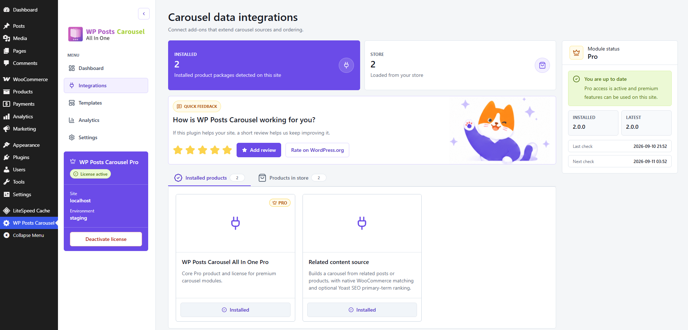

3. Template library

Compare installed templates and browse additional layouts. The demo includes Pro templates and optional extensions.

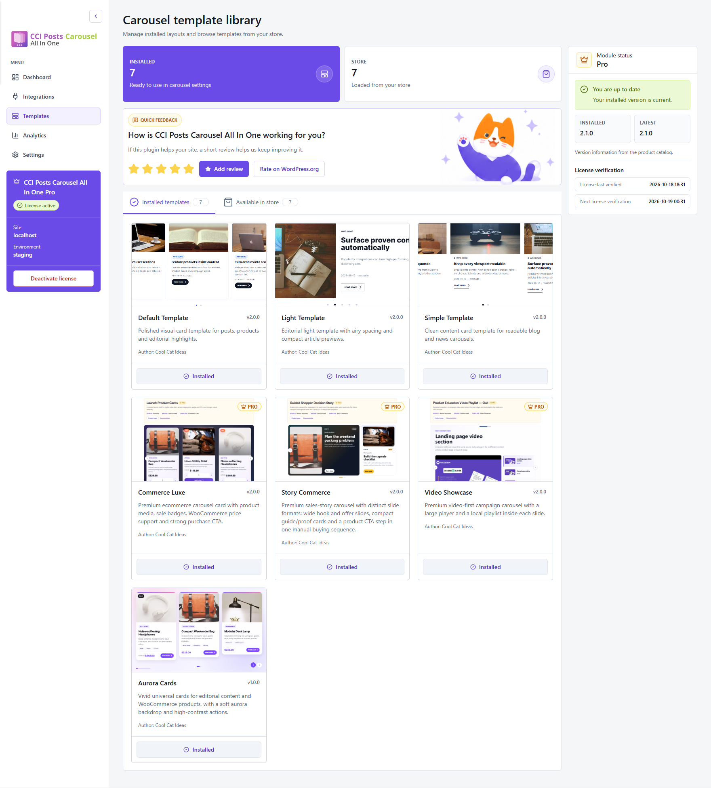

4. Compatibility and responsive defaults

Control carousel libraries and icon assets, and set the default responsive breakpoints.

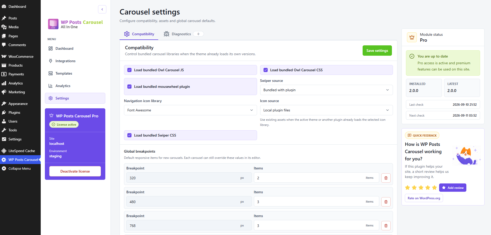

5. Carousel behavior and visual ordering

Choose the rendering engine and slide behavior, then drag cards to arrange the carousel sequence.

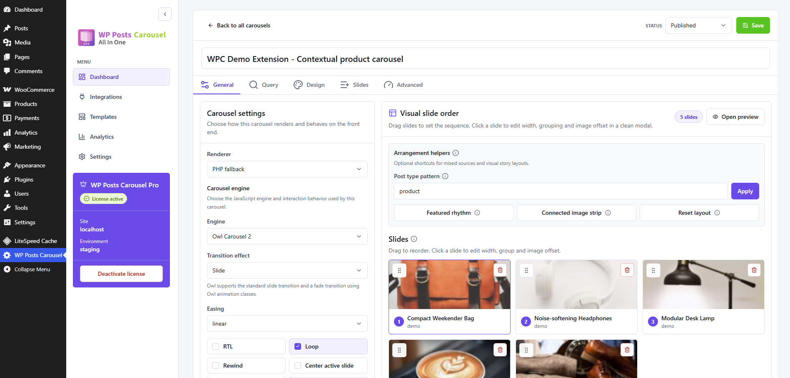

6. Pinned posts and automatic results

Pin selected posts first and fill the remaining places automatically.

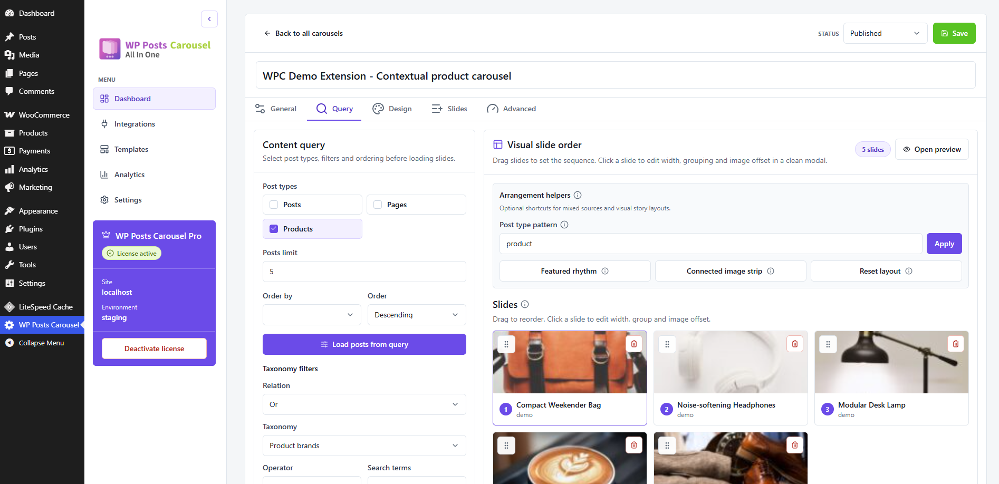

7. Card display settings

Choose which card elements appear and set title and excerpt limits. The price and sale controls shown require Pro.

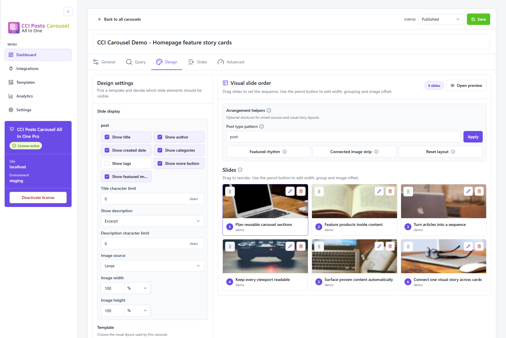

8. Manual slide composition

Search for existing content or add a custom image slide, then arrange its position in the sequence.

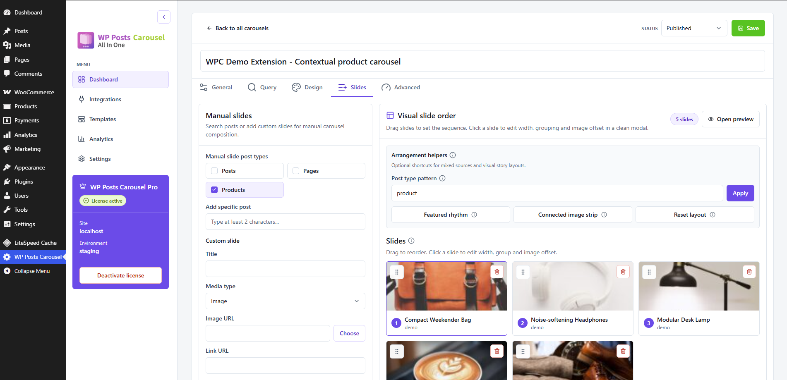

9. Image on hover and advanced settings

Enable an optional second image on mouse hover. The featured image remains the default.

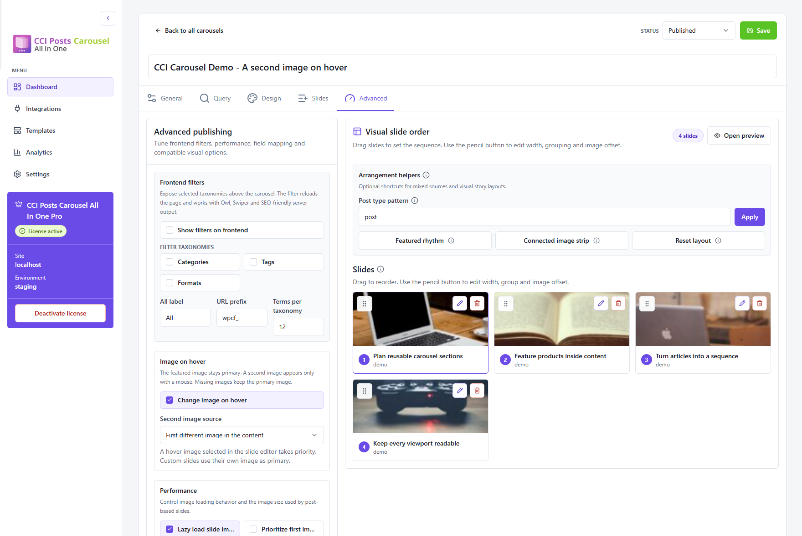

10. Saved carousel shortcodes

Each saved carousel has its own shortcode, publication status and last update date.

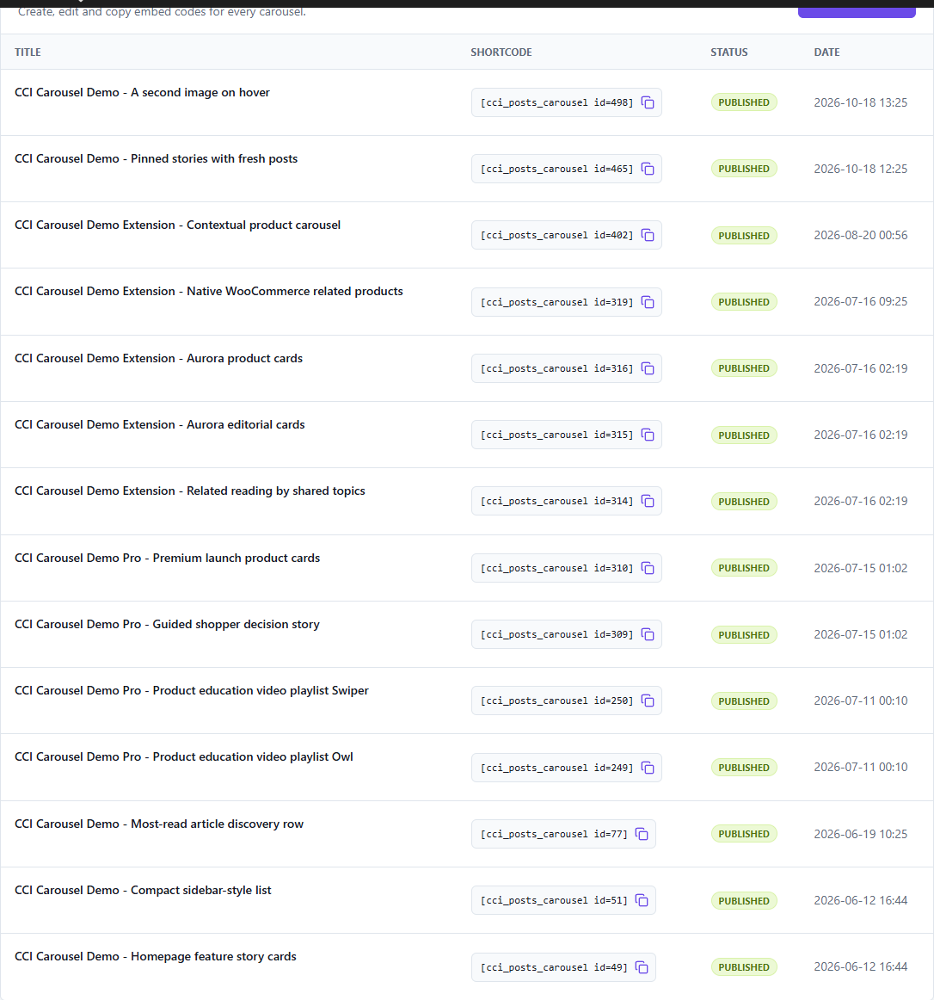

11. Responsive carousel preview

Preview article cards and test the carousel at different widths.

12. Pinned stories with fresh posts

Two pinned posts lead this six-slide example. Four more are selected automatically; three cards are visible on desktop.

13. Article cards

Present WordPress articles as image cards with excerpts and links to the full posts.

14. Aurora product cards

Aurora Cards is an optional template extension. The displayed prices, sale badges and Add to cart actions are supplied by Pro.

15. Aurora editorial cards

The optional Aurora Cards extension presents article images, excerpts and navigation.

16. A second image on hover

The base plugin can show a second image on mouse hover. Touch screens retain the featured image.

17. Story Commerce — Pro

Story Commerce combines a wide opening slide and supporting cards into a numbered shopping story. Included in Pro.

18. Video Showcase — Pro

Video Showcase pairs the active video with a playlist of entries and timestamps. Included in Pro.

19. Commerce Luxe — Pro

Commerce Luxe presents product images, sale prices, quantity controls and Add to cart buttons on a dark carousel background. Included in Pro.

20. Pinning posts in the editor

Reorder pinned posts and let the query fill the remaining places without duplicate posts.

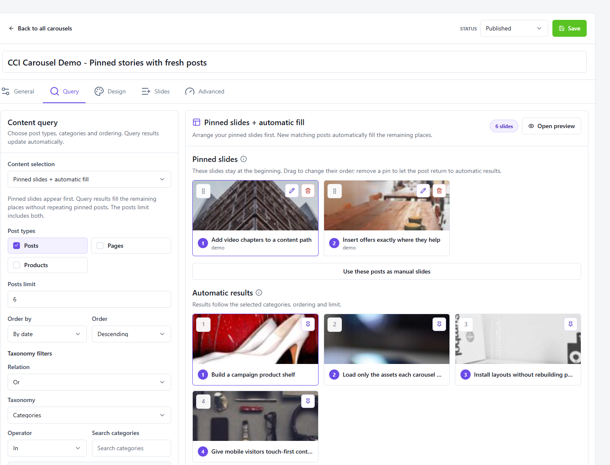

21. Hover image URL and media library

Set a second image for a manual slide by pasting its URL or choosing it from the media library.

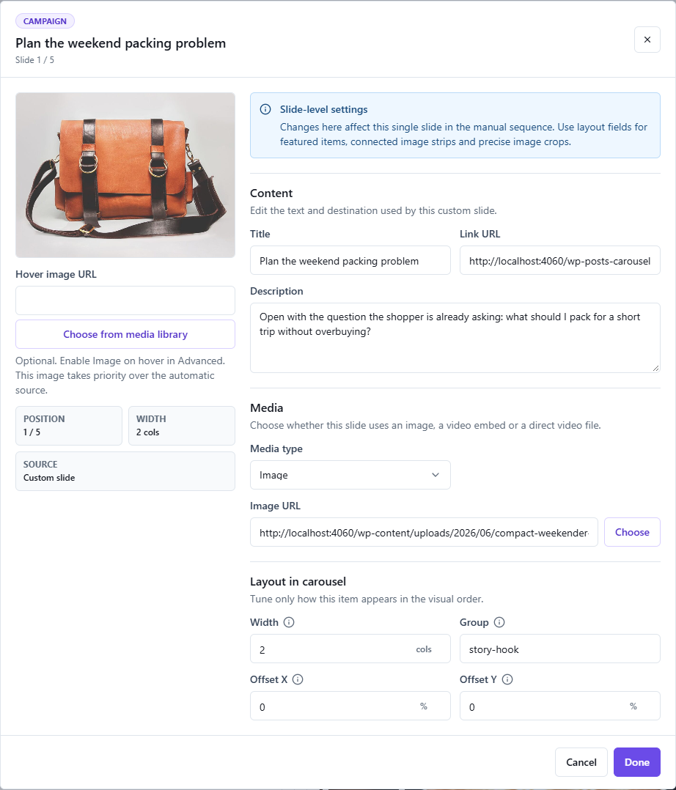

## Configure and customize

- [Configure movement, controls and responsive counts](docs/2.1.0/settings-reference.md).
- [Change a query or add slide data](docs/2.1.0/recipes.md).
- [Override card markup and styles](docs/2.1.0/templates-and-addons.md).
- [Use public PHP methods](docs/2.1.0/method-reference.md) and [filters/actions](docs/2.1.0/hooks-and-api.md).
- [Diagnose empty output, controls or theme conflicts](docs/2.1.0/troubleshooting.md).

To override a template, copy its folder into the active child theme and retain the manifest name. An incomplete override falls back to the next usable template. See the [plugin readme](readme.txt) for release history.

## Support and license

Need a hand, spotted a bug or have an idea? [Open an issue](https://github.com/cool-cat-ideas/cci-posts-carousel-all-in-one/issues) and tell us what you're trying to build. Include your WordPress and plugin versions, but keep passwords and license keys private. For help with an agreed scope, [contact Cool Cat Ideas](https://coolcatideas.com/contact/) about a private support service.

The Free plugin is licensed under [GPL-2.0-or-later](LICENSE).

## Publishing

To rebuild the plugin, see [building from source](docs/building-from-source.md).
Shared components, styles and API adapters are maintained in
[CCI Admin UI](https://github.com/cool-cat-ideas/cci-admin-ui).
The build uses the public release archives pinned by the lockfile; publish the
matching UI source tag and archives before building from a standalone clone.

`README.md` is the GitHub overview. `readme.txt` supplies the WordPress.org listing and screenshot captions. Directory screenshots are versioned in `.wordpress-org/` and excluded from the installable ZIP; graphics used by the plugin itself remain in the package.

See [publishing and versioning](docs/publishing-and-versioning.md) for the GitHub/SVN layout and the read-only package file check.
