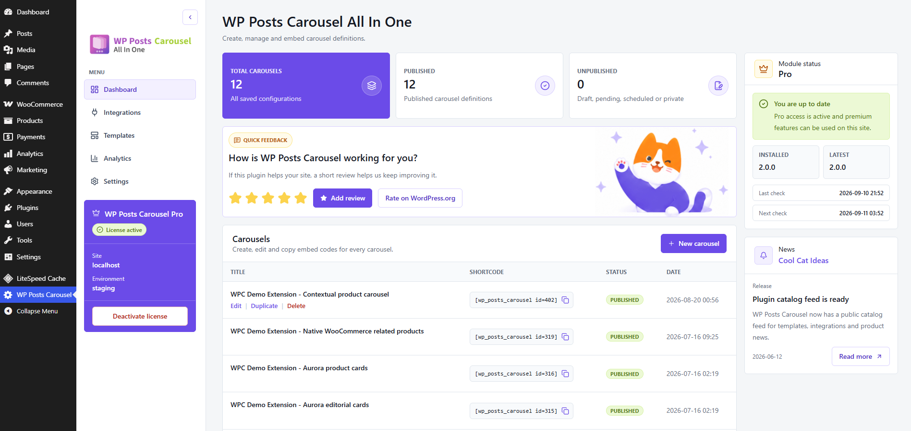

# Upgrade from 1.x to 2.x

If your carousels stopped working after upgrading from 1.x to 2.x, recreate
them in the new editor and replace their placements on your site.

Version 2.x is a rewrite of CCI Posts Carousel All In One. The carousel data model,
editor, widgets and shortcode configuration have changed. Carousel settings
from 1.x are not automatically converted into working 2.x definitions.
Updating the plugin alone does not migrate your existing carousels.

## Before you update

1. Make a backup of your site's database and files.
2. Record each carousel's content source, filters, ordering, item count,
   appearance and responsive settings. Screenshots of the old settings and
   frontend can help you recreate them.
3. List every placement: pages, posts, widget areas, page builder layouts
   and theme templates. One carousel may appear in several places.
4. Recreate and check the carousels on a staging copy before updating the
   live site when possible.

If you have already updated, use your notes or a pre-update backup restored
to a separate staging site as a reference for the old configuration.

## Create replacement carousels

Open **CCI Posts Carousel All In One > Dashboard** in WordPress. In the **Carousels**
section, click **New carousel**.



The dashboard shown above is where you create replacement carousels and copy
their new shortcodes. The example has Pro active; recreating a standard
content carousel does not require a paid license.

1. Give the carousel a name that identifies where you use it.
2. Set its content source, filters, ordering and item limit in the new editor.
3. Choose a template and configure the layout for desktop, tablet and mobile.
4. Check the preview, then save and publish the carousel.
5. Return to the dashboard and copy its shortcode from the **Shortcode** column.
6. Repeat for each carousel you need to recreate.

Use the [Getting started](./user-guide.md) guide for the editor workflow and
[Carousel settings](./settings-reference.md) for individual options. Recreate
custom styling against the new markup; old widget settings, shortcode
attributes and CSS selectors are not a configuration to reuse unchanged.

## Replace every old placement

Creating a replacement carousel does not reconnect the old placements.
Update each place where the 1.x carousel was displayed.

| Placement | What to do in 2.x |
| --- | --- |
| Shortcode in a page or post | Replace the entire old shortcode with the new one copied from the dashboard. |
| Gutenberg block | Add the current CCI Posts Carousel All In One block, select the newly created carousel and remove the old placement. |
| WordPress widget area | Add or reconfigure the current CCI Posts Carousel All In One widget, select the newly created carousel and save the widget area. Remove an obsolete widget if it is still present. |
| Elementor layout | With the Pro Elementor integration active, add or reconfigure the current CCI Posts Carousel All In One widget and select the newly created carousel. Update the page. |
| Theme PHP or another shortcode-capable area | Replace the old embed with the new shortcode and save the template or layout. Keep theme changes in a child theme. |

The new shortcode references a saved carousel by its ID:

```text
[cci_posts_carousel id="123"]
```

Here, `123` is an example. Copy the actual shortcode generated for your new
carousel. Even though the shortcode name is familiar, the old configuration
and old ID do not replace a newly created 2.x definition.

See [Publishing](./user-guide.md) for the supported embedding methods.

## Check the result

1. Save the updated pages, widget areas and templates.
2. Clear page cache and any cached or combined plugin assets.
3. Visit every carousel placement on desktop and mobile. Check the content,
   number of visible items, links, arrows and layout.
4. If a carousel is still empty, confirm that it is published, that the
   placement selects the new carousel and that its source has matching content.

Clearing cache alone cannot convert a 1.x configuration. If the replacement
is correctly configured and embedded but still fails, use
[Troubleshooting](./troubleshooting.md) or follow the [Support](https://coolcatideas.com/docs/cci-posts-carousel-all-in-one/2.0.x/support/) guide.
