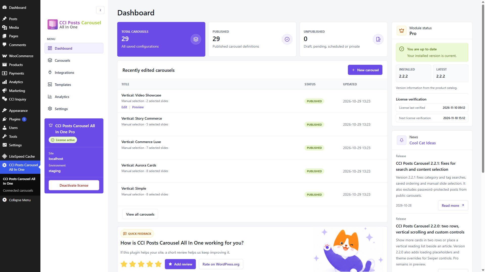
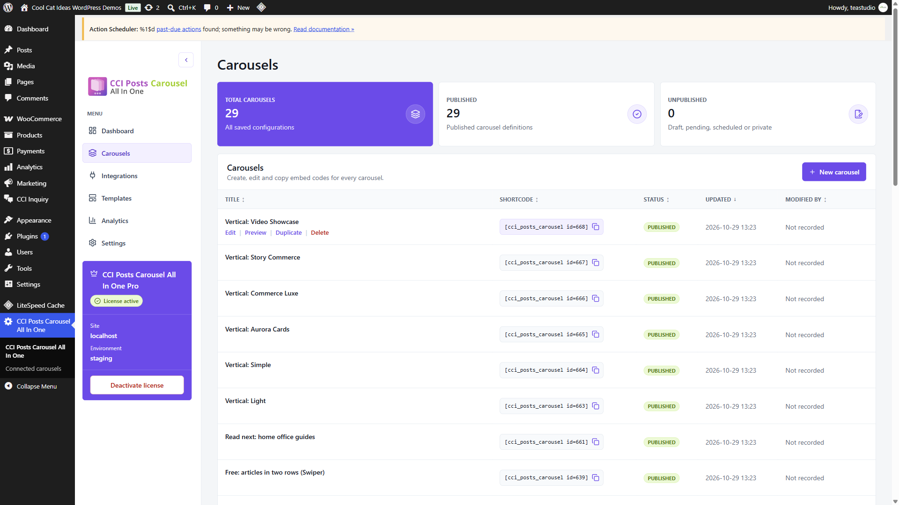
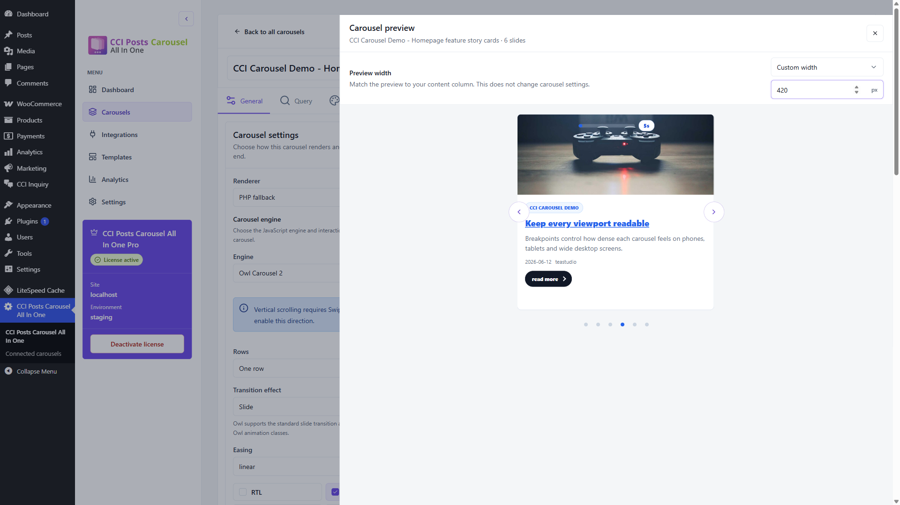
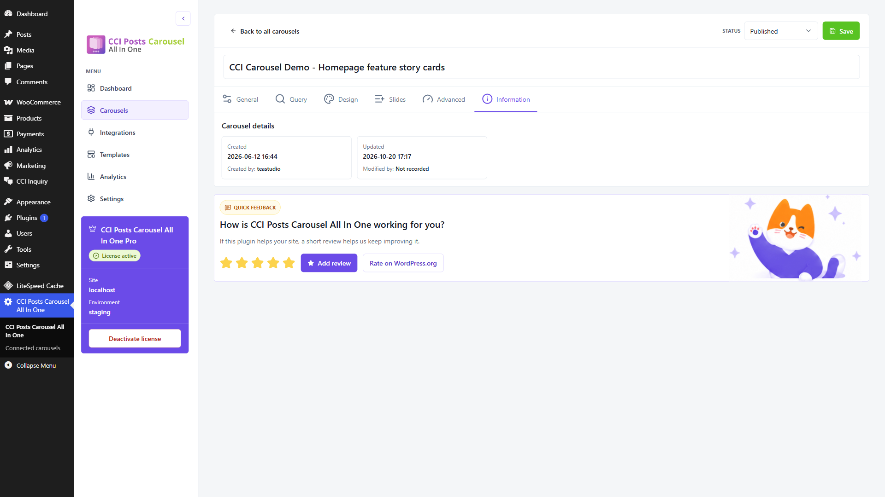

# Dashboard and Carousels

Use Dashboard to resume recent work. Open Carousels when you need to search
through the whole saved collection, compare statuses or copy a shortcode.
Both screens open the same carousel editor and saved preview.

## Return to recent work

Open **CCI Posts Carousel All In One > Dashboard**. The overview shows the
five most recently updated saved carousels, with separate Title, Status and
Updated columns. Details below the title identify an automatic content source
or the number of manually selected slides. Automatic sources do not show an
invented fixed slide count: their matching content can change.

Move the pointer over a title row, or focus its title with the keyboard, to
reveal **Edit** and **Preview**. Use **View all carousels** for the full collection
or **New carousel** to create a definition. Drafts remain distinguishable from
published carousels through the Status column.

## Manage the full collection

Open **Carousels** from the plugin menu. This screen has five columns:

| Column | What it tells you |
| --- | --- |
| Title | The internal name and actions for this saved carousel. |
| Shortcode | The embed code, with a copy button. |
| Status | Whether the definition is published, a draft or another WordPress state. |
| Updated | The date of the last saved configuration change. |
| Modified by | The editor recorded for that change, when known. |

Click a column heading to sort the list. Click it again to reverse the order.
For example, sort Updated to find recent changes or Modified by to review work
by a particular editor. Missing editor names remain at the end of the list.

The actions below each title provide **Edit**, **Preview**, **Duplicate** and
**Delete**. Copy the shortcode from its own column when adding a placement.
Duplicating a definition creates a separate carousel; changes to the copy do
not change the original. Deleting a carousel can leave its existing placements
without content, so check where you embedded it first.

## Preview at your content column width

Choose **Preview** below a title, or **Open preview** inside the editor. A list
preview uses the saved configuration. The editor preview uses the current
editor configuration, so it can include changes you have not saved yet.

1. Choose **Full width** to fill the preview panel, or select one of the
   responsive widths configured for this carousel.
2. Choose **Custom width** and enter **Width in pixels** when your page column
   has a different width, for example 420 px.
3. Test arrows, pagination and the card content. Press Escape or use Close
   preview to return to your work.

Changing this width affects only the preview. It does not change responsive
item counts, the saved carousel or the width of a published placement.
Vertical scrolling does not imply a fixed sidebar width: the same definition
can appear in different columns on different pages. The preview is a layout
check, not a reproduction of every style supplied by your theme. Check the
actual published placement too.

## Check creation and editing details

Open a carousel and select **Information**, after Advanced. The read-only panel
shows Created, Created by, Updated and Modified by. Save a change to record the
current WordPress editor and refresh the update details.

**Not recorded** means an earlier save did not contain editor information. It
is not replaced with the creator or the currently signed-in administrator.
This avoids attributing an old change to the wrong person. A carousel can have
a creator and a different last editor.

## If a preview is empty

Confirm that the selected content is published and the query matches it.
Check the chosen template's requirements and any Pro license requirements.
If the preview request fails, verify your WordPress session and whether a
security or caching plugin blocks authenticated REST requests. An admin
preview is protected; it does not make drafts publicly available.

See [Troubleshooting](./troubleshooting.md) and [Support](./support.md) for the details
to include in a report. Follow [Publishing](./publishing.md) to embed the saved
carousel on the site.
